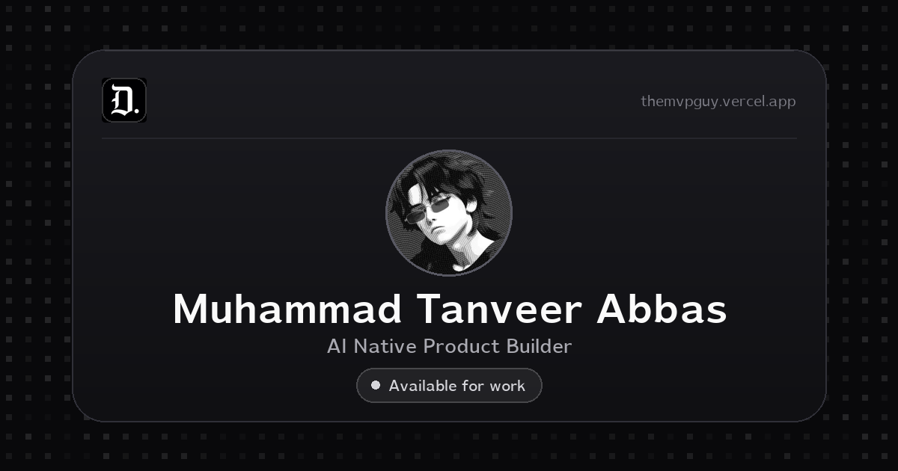

# DevCard

An interactive 3D developer profile card. Share your links, social profiles and payment options in one polished page.

Live demo: [themvpguy.vercel.app](https://themvpguy.vercel.app/)



---

## What it looks like

- Animated shining border that moves around the card
- Smooth 3D tilt on mouse hover
- Profile photo, name, title and availability status
- Skill badges for the stack
- Book a Call and Portfolio buttons
- Email with one click copy
- Social icons: LinkedIn, GitHub, X, Bluesky, Medium
- Resume download button
- Dark and light mode toggle with a click sound
- Favicon and app icons in every size, sharp on phones, tablets and 4K screens
- Structured data, sitemap, robots rules and LLM text files for search and AI crawlers
- Fully responsive on all screen sizes
- Dithered pixel backdrop that reacts to mouse and touch in the backdrop only, hidden on small screens (under 768px wide) so phones show the plain page colour and save battery

---

## Background

The backdrop is a dithered pixel field drawn with Three.js. It is built to look right on every screen:

- It covers the whole viewport on any screen size, from a small phone to a 4K monitor. The canvas follows the element box and the drawing buffer follows the device pixel ratio, so the pixel grid stays the same visual size everywhere
- The field is hidden on screens under 768px wide. The page body colour matches the backdrop colour exactly (`#fafafa` light, `#050607` dark), so nothing looks empty and no seam shows
- A static pixel layer paints on the first frame and stays whenever the animated field cannot run, so the backdrop is never a flat colour or a blank canvas
  - while the animated field is still downloading
  - when the visitor asked for reduced motion
  - when WebGL is missing, blocked, or the GPU drops the context
- The body colour matches the backdrop colour, so a collapsing mobile toolbar, a rubber band scroll or a rounded screen corner never shows a seam of another colour
- Pointer input drives the backdrop only. Moving the mouse trails a liquid wake through the pixels, and a click or a tap sends a ripple out. Those listeners sit on the window and are passive, so they never block an event and the card keeps its own hover tilt, taps, links and copy button. The reaction is always in the backdrop, never on the card

The field lives in `components/pixel-blast/`. To tune it, change `pixelSize`, `patternDensity`, `speed`, `liquidStrength` and the two theme colours in `components/pixel-blast/pixel-blast-background.tsx`.

---

## Quick start

```bash
git clone https://github.com/MuhammadTanveerAbbas/Devcard.git
cd Devcard
pnpm install
pnpm dev
```

Open [http://localhost:3000](http://localhost:3000).

Node.js 20.9 or newer is required. TypeScript 5.1 or newer is required.

---

## How to customize it for yourself

The visible card lives in one place: the `PROFILE` constant at the top of `components/profile-card.tsx`.

```ts
const PROFILE = {
  name: "Your Name",
  title: "Your Title", // shown in the pill badge below your name
  status: "Available for work", // the pill below your name, change or remove
  statusDetail: "Booking new builds from next month", // shown on hover, keep it short
  about: "Your one-liner bio.",

  profileImage: "/Me.webp", // drop your photo in /public and update this path

  email: "you@example.com",
  calUrl: "https://cal.com/yourhandle", // Book a Call button
  portfolioUrl: "https://yoursite.com", // Portfolio button
  cvUrl: "/Resume.pdf", // drop your PDF in /public
};
```

Save the file and the card updates instantly.

The social row and the skill badges come from `components/brand-marks.tsx`. Edit `SOCIALS` to change the links and `SKILLS` to change the badges. Delete an entry to remove that icon or badge.

---

## Replacing your photo

1. Drop your image into the `/public` folder. WebP is recommended, JPG, PNG and JFIF also work.
2. Update `profileImage` in the `PROFILE` constant:

```ts
profileImage: "/your-photo.jpg",
```

---

## Replacing your CV

1. Drop your PDF into `/public` and name it `Resume.pdf`, or anything you like
2. Update `cvUrl`:

```ts
cvUrl: "/YourName-Resume.pdf",
```

---

## Hiding buttons or social icons

Nothing on the card renders conditionally, so an empty link leaves the button in place and it simply does nothing when clicked. To remove a piece of the card, delete its block in `components/profile-card.tsx`:

1. Resume button, the button with the download icon in the top right cluster
2. Book a Call, the availability block under your title and the button in the action row
3. Portfolio, the button next to Book a Call
4. Email, the copy row near the bottom

Social icons come from the `SOCIALS` array in `components/brand-marks.tsx`. Delete an entry to remove that icon.

---

## Changing the availability status

Update the `status` field:

```ts
status: "Open to freelance",
// or
status: "Not available",
```

The pill uses the same style as the `Dark` and `Resume` buttons in the top bar, so it picks up light and dark mode automatically.

To remove the block completely, delete the `status` and `statusDetail` lines and remove the availability button from the JSX in `components/profile-card.tsx`.

---

## Favicon and app icons

`public/Fevicon.webp` is the master artwork. Every other icon file is generated from it, so the mark stays sharp everywhere.

| File | Size | Used by |
| --- | --- | --- |
| `public/Fevicon.webp` | 500x500 | The source file, also linked as a WebP icon |
| `app/favicon.ico` | 16, 32, 48, 64 | Browser tabs, bookmarks and older browsers |
| `app/icon.png` | 512x512 | Modern browsers, high density and retina tabs |
| `app/apple-icon.png` | 180x180 | iPhone and iPad home screen |
| `public/icon-192.png` | 192x192 | Android home screen and the web manifest |
| `public/icon-512.png` | 512x512 | Android splash screen and the web manifest |
| `app/opengraph-image.png` | 1200x630 | Link previews on Slack, WhatsApp, LinkedIn, X |
| `app/twitter-image.png` | 1200x630 | X card preview |

Next.js adds all of these to the page head automatically. `app/layout.tsx` adds the WebP entry and the explicit sizes as well, so the browser picks the right file for the screen density. Nothing else to wire.

### Regenerate the icons after swapping the artwork

Replace `public/Fevicon.webp` with your own file, then run:

```bash
python3 scripts/make-icons.py
```

It needs Python with Pillow (`pip install pillow`). The script rewrites the ICO, the 512 PNG, the Apple icon and both Android PNGs from the new artwork.

### Share image

The share card is a 1200x630 picture, built from the profile photo, the brand mark and the LT Veritas fonts. Rebuild it after a name, role or photo change:

```bash
python3 scripts/make-og-image.py
```

The script writes both PNGs and drops a preview sheet with a square chat crop in `/tmp/devcard-share-preview`.

The alt text lives in `app/opengraph-image.alt.txt` and `app/twitter-image.alt.txt`. Next.js turns those files into `og:image:alt` and `twitter:image:alt`. Edit them when you change the artwork.

### Share image design rules

The card follows a few rules so it holds up on every platform:

1. 1200x630 pixels, the 1.91 by 1 ratio that X, LinkedIn, Facebook, Slack, Discord and WhatsApp show without cropping
2. Small file, 78 KB, comfortably under the 300 KB ceiling some chat apps enforce
3. The name is the largest element, so the card still reads at chat thumbnail size
4. The important content sits inside the middle 1000 pixels, so a square crop never cuts the name
5. The brand mark is badged top left, the avatar is circular, the palette stays monochrome to match the page
6. No emoji, no dashes, no hairline text that turns to mush when scaled down

---

## SEO, crawlers and LLM data

Crawler facing data sits in `lib/site.ts`. Change it there once and every surface follows: the meta tags, the structured data, `robots.txt`, `sitemap.xml` and the manifest.

| File | What it produces |
| --- | --- |
| `lib/site.ts` | Name, title, description, keywords, social links, skills, site URL |
| `app/layout.tsx` | Title, description, canonical URL, Open Graph, X card, robots rules, theme colour, icon links |
| `app/page.tsx` | JSON-LD graph with `Person`, `ProfilePage` and `WebSite` nodes |
| `app/robots.ts` | `/robots.txt`, allows every crawler and names the AI agents, links the sitemap |
| `app/sitemap.ts` | `/sitemap.xml` |
| `app/manifest.ts` | `/manifest.webmanifest`, makes the page installable with proper icons |
| `public/llms.txt` | Short markdown summary for LLMs, per the [llms.txt spec](https://llmstxt.org/) |
| `public/llms-full.txt` | Long form markdown profile for LLMs |

Both LLM files are linked from the page head as `alternate` links, so an agent can find them from the page alone.

### Social preview tags and character limits

Platforms cut long text and reject heavy images. These are the values in use, kept inside the usual limits.

| Tag | Set in | Value and limit |
| --- | --- | --- |
| `title` | `app/layout.tsx` | 50 characters, limit is 60 |
| `description` | `lib/site.ts` as `DESCRIPTION` | 124 characters, limit is 155 |
| `og:title` and `twitter:title` | `app/layout.tsx` | 50 characters, limit is 70 |
| `og:description` and `twitter:description` | `lib/site.ts` as `SOCIAL_DESCRIPTION` | 115 characters, limit is 125 for WhatsApp and LinkedIn |
| `og:image`, `og:image:width`, `og:image:height`, `og:image:type` | `app/opengraph-image.png` | 1200x630 PNG, 78 KB, written by Next.js automatically |
| `og:image:alt` | `app/opengraph-image.alt.txt` | 111 characters |
| `og:type` | `app/layout.tsx` | `profile`, with first name, last name and username |
| `og:site_name`, `og:locale`, `og:url` | `app/layout.tsx` | `DevCard`, `en_US`, the canonical URL |
| `twitter:card` | `app/layout.tsx` | `summary_large_image` |
| `twitter:creator` and `twitter:site` | `lib/site.ts` as `X_HANDLE` | `@m_tanveerabbas` |
| `twitter:image` and `twitter:image:alt` | `app/twitter-image.png` and its alt file | 1200x630 PNG |
| `theme-color` | `app/layout.tsx` | white for light mode, near black for dark mode |
| `robots` | `app/layout.tsx` | index and follow, with `max-image-preview:large` so search keeps large thumbnails |
| `manifest` | `app/manifest.ts` | installable app name, colours and 192 and 512 icons |

### Pointing the site at your own domain

Change one line in `lib/site.ts`:

```ts
export const SITE_URL = "https://your-domain.com";
```

The canonical tag, Open Graph URLs, the sitemap, `robots.txt` and the JSON-LD all read from that value.

### After you deploy

1. Add the site in [Google Search Console](https://search.google.com/search-console) and submit `sitemap.xml`
2. Check the share preview with the [Open Graph debugger](https://www.opengraph.xyz/) or the X card validator
3. Validate the structured data with the [Rich Results test](https://search.google.com/test/rich-results)

---

## Environment variables

None required. This is a fully static frontend app. No backend, no database, no API keys.

---

## Tech stack

- [Next.js 16](https://nextjs.org/) with the App Router
- [React 19](https://react.dev/)
- [Tailwind CSS v4](https://tailwindcss.com/)
- [shadcn/ui](https://ui.shadcn.com/) and Radix UI components
- [next-themes](https://github.com/pacocoursey/next-themes) for dark mode
- [Three.js](https://threejs.org/) and [postprocessing](https://github.com/pmndrs/postprocessing) for the pixel blast background
- [Lucide React](https://lucide.dev/) icons
- [Vercel Analytics](https://vercel.com/analytics)

---

## Scripts

| Command | What it does |
| --- | --- |
| `pnpm dev` | Start the dev server on port 3000 |
| `pnpm build` | Build for production |
| `pnpm start` | Run the production build |
| `pnpm lint` | Run ESLint |

---

## Deployment

### Vercel, recommended

Push to GitHub, then import the repo at [vercel.com/new](https://vercel.com/new). Zero config needed.

Or from the CLI:

```bash
pnpm i -g vercel
vercel
```

### Other platforms

```bash
pnpm build
pnpm start
```

Works on any Node.js 20.9 or newer host, such as Railway, Render or Fly.io.

---

## Project structure

```
.
├── app/
│   ├── fonts/                 # LT Veritas, self hosted
│   ├── favicon.ico            # tab icon, generated from Fevicon.webp
│   ├── icon.png               # 512x512 app icon
│   ├── apple-icon.png         # iOS home screen icon
│   ├── opengraph-image.png    # 1200x630 share card
│   ├── opengraph-image.alt.txt # alt text for the share card
│   ├── twitter-image.png      # 1200x630 share card for X
│   ├── twitter-image.alt.txt  # alt text for the X share card
│   ├── globals.css            # Tailwind theme tokens
│   ├── layout.tsx             # metadata, fonts, theme provider
│   ├── page.tsx               # home page and JSON-LD
│   ├── not-found.tsx          # 404 page
│   ├── manifest.ts            # /manifest.webmanifest
│   ├── robots.ts              # /robots.txt
│   └── sitemap.ts             # /sitemap.xml
├── components/
│   ├── profile-card.tsx       # the card, edit the PROFILE constant here
│   ├── brand-marks.tsx        # social and skill logos, SOCIALS and SKILLS
│   ├── pixel-blast/           # animated background
│   ├── theme-provider.tsx     # next-themes wrapper
│   └── ui/                    # shadcn/ui components
├── hooks/
│   ├── use-mobile.ts
│   ├── use-toast.ts
│   └── use-toggle-sound.ts
├── lib/
│   ├── site.ts                # name, links and keywords for metadata, robots, sitemap
│   └── utils.ts
├── public/
│   ├── Fevicon.webp           # master icon artwork
│   ├── icon-192.png           # Android and manifest icons
│   ├── icon-512.png
│   ├── Me.webp                # profile photo
│   ├── Resume.pdf             # resume
│   ├── llms.txt               # short LLM summary
│   ├── llms-full.txt          # long LLM profile
│   └── toggle button *.mp3    # theme toggle click sounds
├── scripts/
│   ├── make-icons.py          # rebuilds every icon from Fevicon.webp
│   └── make-og-image.py       # rebuilds the 1200x630 share cards
└── README.md
```

---

## License

MIT, copyright [Muhammad Tanveer Abbas](https://themvpguy.vercel.app/)

- X: [x.com/m_tanveerabbas](https://x.com/m_tanveerabbas)
- LinkedIn: [linkedin.com/in/muhammadtanveerabbas](https://linkedin.com/in/muhammadtanveerabbas)
- GitHub: [github.com/muhammadtanveerabbas](https://github.com/muhammadtanveerabbas)
